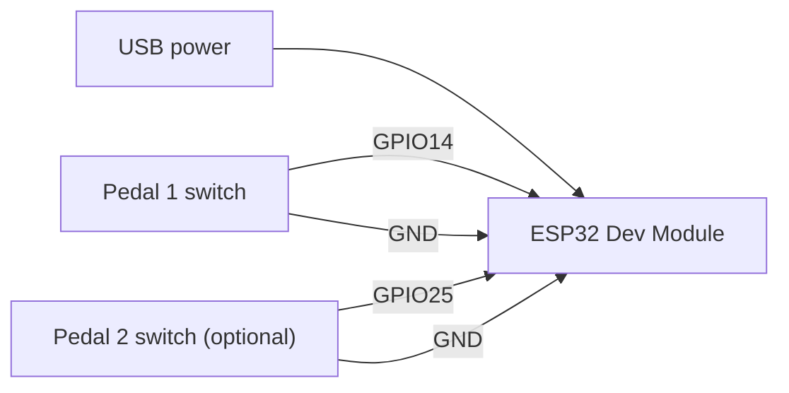
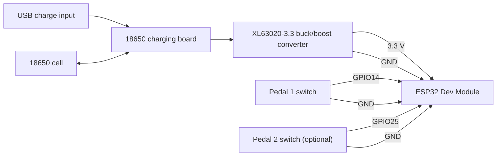

# ESP32 Foot Pedal (up to 2 pedals)

A Bluetooth (BLE) foot pedal keyboard built on an ESP32. Each pedal presses a configurable key or key combo on whatever device it's paired with. Keybinds and presets are changed from a small web page served by the pedal itself, and firmware can be updated over Wi-Fi (OTA).

The same sketch supports **one or two pedals** and runs in either of two builds: **USB powered** or **battery powered**.

**Setup instructions (after you've built it and powered it on): https://foot-pedal.vercel.app/**

## Choose your build

| | USB powered | Battery powered |
| --- | --- | --- |
| Power | USB cable into the ESP32 | 18650 cell, charger board and 3.3 V converter |
| Wiring | Switches only | Switches plus power circuit |
| Enclosure | MakerWorld link coming soon | MakerWorld link coming soon |
| Good for | Desk setups, simplest build | Wireless use anywhere |

Both builds use the same firmware and the same switch wiring. Only the power side differs.

## Features

- One or two pedals, each with its own active keybind
- BLE keyboard output (no Wi-Fi needed for the pedals to work)
- Modifier combos, e.g. `CTRL+ALT+SHIFT+F12`, `CTRL+SHIFT+t`, `ALT+SPACE`
- Case-sensitive single characters (`t` sends lowercase, `T` sends uppercase)
- Five saved presets per pedal, switchable from the web UI
- First-boot Wi-Fi setup through a captive portal. No credentials are compiled into the firmware
- Settings persist across reboots (ESP32 NVS)
- OTA support in the firmware (needs a partition scheme with an OTA slot, see below)
- Handles both pedals held at once without stuck modifiers

### One pedal or two

This is an "up to 2 pedals" sketch. The web interface always shows keybind and preset settings for both pedals, even if you only built one. For a single-pedal build, wire the switch to Pedal 1 (GPIO14) and ignore the Pedal 2 settings. Leaving GPIO25 unconnected is fine, because the internal pull-up keeps it idle.

## Firmware

Use `esp32_foot_pedal_wifi_setup_guided.ino`, attached to each [release](../../releases). It is the same file for both builds.

The other `.ino` files in this repo are earlier iterations and are kept for reference.

**Arduino IDE settings**

| Setting | Value |
| --- | --- |
| Board | ESP32 Dev Module |
| Partition Scheme | **Huge APP (3MB No OTA/1MB SPIFFS)** |
| Library: ESP32 BLE Keyboard | by T-vK |
| Library: WiFiManager | by tzapu |

**The sketch must be flashed with the Huge APP partition scheme** (Tools > Partition Scheme in the Arduino IDE). BLE, Wi-Fi, the web server and WiFiManager together are too large for the default partition, so with the default scheme the upload fails with a "sketch too big" error.

Huge APP has no spare partition for over-the-air updates, so flash over USB. See the OTA note under Usage notes.

The Arduino IDE expects a sketch to live in a folder with the same name. Put the file in a folder called `esp32_foot_pedal_wifi_setup_guided/` before opening it.

## Wiring the pedals (both builds)

Each pedal switch connects one GPIO pin to GND. The firmware enables the ESP32's internal pull-up on both pins, so **no external resistors are needed**. A pressed switch pulls the pin LOW.

| Pedal | ESP32 pin | Other switch terminal |
| --- | --- | --- |
| Pedal 1 | GPIO14 | GND |
| Pedal 2 (optional) | GPIO25 | GND |

If you want different pins, change `PEDAL_1_PIN` and `PEDAL_2_PIN` near the top of the sketch. The classic ESP32-WROOM has no GPIO24, so pick another valid GPIO.

## Build 1: USB powered

### Bill of materials

| Qty | Part | Notes |
| --- | --- | --- |
| 1 | ESP32 Dev Module (classic ESP32-WROOM) | GPIO14 and GPIO25 are used for the pedals |
| 1-2 | Mechanical keyboard switch | One per pedal |
| 1 | USB cable | Powers the ESP32 and is used for flashing |
| 1 | 3D-printed pedal enclosure | MakerWorld link coming soon |
| - | Hookup wire, solder | |

### Wiring

## Build 2: Battery powered

### Bill of materials

| Qty | Part | Notes |
| --- | --- | --- |
| 1 | ESP32 Dev Module (classic ESP32-WROOM) | GPIO14 and GPIO25 are used for the pedals |
| 1-2 | Mechanical keyboard switch | One per pedal |
| 1 | 18650 Li-ion cell | Power source |
| 1 | 18650 charging board | Charges the cell over USB |
| 1 | XL63020-3.3 buck/boost converter module | Steps the battery voltage to a steady 3.3 V for the ESP32 |
| 1 | 3D-printed pedal enclosure (top and bottom) | Cavities for the battery, charger and converter. MakerWorld link coming soon |
| - | Hookup wire, solder | |

> Check the part list against your own build before relying on it, especially the charging board model and where the converter output connects to the ESP32.

### Wiring

## First-time setup

1. Flash the firmware to the ESP32.
2. Power it on, then pair **ESP32 Foot Pedal** from your computer's or phone's Bluetooth settings. The pedals work as soon as it connects.
3. To use the web interface, join the **ESP32-Pedal-Setup** Wi-Fi network from a phone or laptop and enter your home Wi-Fi details in the portal that opens. The portal stays open for 3 minutes.
4. Follow the guide at https://foot-pedal.vercel.app/ for the rest.

## Usage notes

**Defaults**

- Pedal 1 sends `t`
- Pedal 2 sends `CTRL+ALT+SHIFT+F12`

**Changing keybinds.** Once the pedal is on your Wi-Fi, open its IP address in a browser. The IP is shown in the Serial Monitor at 115200 baud. Set the active keybind for each pedal there, or save up to five named presets per pedal and activate them with one click.

**Keybind syntax.** Join keys with `+`.

- Modifiers: `CTRL`, `SHIFT`, `ALT`, `WIN` (also `CONTROL`, `WINDOWS`, `GUI`)
- Special keys: `SPACE`, `ENTER`, `TAB`, `ESC`, `BACKSPACE`, `DELETE`, `INSERT`, `UP`, `DOWN`, `LEFT`, `RIGHT`, `HOME`, `END`, `PAGEUP`, `PAGEDOWN`
- Function keys: `F1` to `F12`
- Any single printable character, case preserved

**Resetting Wi-Fi.** Hold both pedals while powering on and keep holding for about 5 seconds. The saved credentials are erased and the setup portal opens again. Releasing early keeps them. This reset needs both pedals, so a single-pedal build can't use it. Reflash the firmware, or temporarily short GPIO25 to GND while powering on.

**Wi-Fi is optional.** If the portal times out or no network is available, Bluetooth still works. The web UI and OTA only start once Wi-Fi is connected. Reboot to try setup again.

**OTA updates.** The sketch includes ArduinoOTA and the device appears as `esp32-pedal` on your network. OTA only works if the board was flashed with a partition scheme that includes an OTA slot. With Huge APP (required for the first flash) there is no OTA slot, so update the firmware over USB.

**Security.** The web interface and OTA have no password. Only use the pedal on a network you trust.

## Roadmap

- MakerWorld links for the USB and battery enclosures
- Integrate into the PrintPlease website

## License

No license has been chosen yet.
