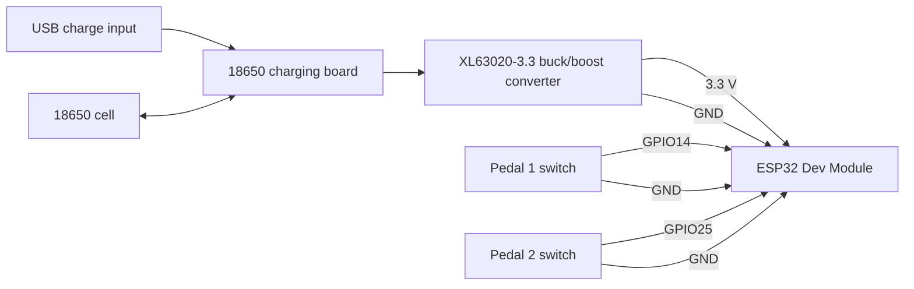

# ESP32 Dual Foot Pedal

A battery-powered, two-pedal Bluetooth (BLE) keyboard built on an ESP32. Each pedal presses a configurable key or key combo on whatever device it's paired with. Keybinds and presets are changed from a small web page served by the pedal itself, and firmware can be updated over Wi-Fi (OTA).

**Setup instructions (after you've built it and powered it on): https://foot-pedal.vercel.app/**

## Features

- Two independent pedals, each with its own active keybind
- BLE keyboard output (no Wi-Fi needed for the pedals to work)
- Modifier combos, e.g. `CTRL+ALT+SHIFT+F12`, `CTRL+SHIFT+t`, `ALT+SPACE`
- Case-sensitive single characters (`t` sends lowercase, `T` sends uppercase)
- Five saved presets per pedal, switchable from the web UI
- First-boot Wi-Fi setup through a captive portal. No credentials are compiled into the firmware
- Settings persist across reboots (ESP32 NVS)
- OTA firmware updates
- Handles both pedals held at once without stuck modifiers

## Firmware

Use `esp32_foot_pedal_wifi_setup_guided.ino`, attached to each [release](../../releases).

The other `.ino` files in this repo are earlier iterations and are kept for reference.

**Arduino IDE settings**

| Setting | Value |
| --- | --- |
| Board | ESP32 Dev Module |
| Library: ESP32 BLE Keyboard | by T-vK |
| Library: WiFiManager | by tzapu |

The Arduino IDE expects a sketch to live in a folder with the same name. Put the file in a folder called `esp32_foot_pedal_wifi_setup_guided/` before opening it.

## Bill of materials

| Qty | Part | Notes |
| --- | --- | --- |
| 1 | ESP32 Dev Module (classic ESP32-WROOM) | GPIO14 and GPIO25 are used for the pedals |
| 2 | Mechanical keyboard switch | One per pedal, used as the foot switch |
| 1 | 18650 Li-ion cell | Power source |
| 1 | 18650 charging board | Charges the cell over USB |
| 1 | XL63020-3.3 buck/boost converter module | Steps the battery voltage to a steady 3.3 V for the ESP32 |
| 2 | 3D-printed pedal (top and bottom) | Enclosure with cavities for the battery, charger and converter |
| - | Hookup wire, solder | |

> Check the part list against your own build before relying on it, especially the charging board model and where the converter output connects to the ESP32.

## Wiring

Each pedal switch connects one GPIO pin to GND. The firmware enables the ESP32's internal pull-up on both pins, so **no external resistors are needed**. A pressed switch pulls the pin LOW.

| Pedal | ESP32 pin | Other switch terminal |
| --- | --- | --- |
| Pedal 1 | GPIO14 | GND |
| Pedal 2 | GPIO25 | GND |

If you want different pins, change `PEDAL_1_PIN` and `PEDAL_2_PIN` near the top of the sketch. The classic ESP32-WROOM has no GPIO24, so pick another valid GPIO.

## First-time setup

1. Flash the firmware to the ESP32.
2. Power it on, then pair **ESP32 Foot Pedal** from your computer's or phone's Bluetooth settings. The pedals work as soon as it connects.
3. To use the web interface, join the **ESP32-Pedal-Setup** Wi-Fi network from a phone or laptop and enter your home Wi-Fi details in the portal that opens. The portal stays open for 3 minutes.
4. Follow the guide at https://foot-pedal.vercel.app/ for the rest.

## Usage notes

**Defaults**

- Pedal 1 sends `t`
- Pedal 2 sends `CTRL+ALT+SHIFT+F12`

**Changing keybinds.** Once the pedal is on your Wi-Fi, open its IP address in a browser. The IP is shown in the Serial Monitor at 115200 baud. Set the active keybind for each pedal there, or save up to five named presets per pedal and activate them with one click.

**Keybind syntax.** Join keys with `+`.

- Modifiers: `CTRL`, `SHIFT`, `ALT`, `WIN` (also `CONTROL`, `WINDOWS`, `GUI`)
- Special keys: `SPACE`, `ENTER`, `TAB`, `ESC`, `BACKSPACE`, `DELETE`, `INSERT`, `UP`, `DOWN`, `LEFT`, `RIGHT`, `HOME`, `END`, `PAGEUP`, `PAGEDOWN`
- Function keys: `F1` to `F12`
- Any single printable character, case preserved

**Resetting Wi-Fi.** Hold both pedals while powering on and keep holding for about 5 seconds. The saved credentials are erased and the setup portal opens again. Releasing early keeps them.

**Wi-Fi is optional.** If the portal times out or no network is available, Bluetooth still works. The web UI and OTA only start once Wi-Fi is connected. Reboot to try setup again.

**OTA updates.** The device appears as `esp32-pedal` on your network and can be selected as a network port in the Arduino IDE.

**Security.** The web interface and OTA have no password. Only use the pedal on a network you trust.

## Roadmap

- Integrate into the PrintPlease website

## License

No license has been chosen yet.
